<div align="center">

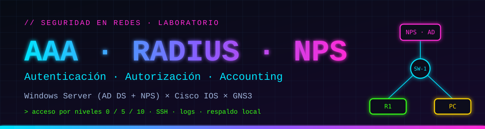

# 🔐 Laboratorio AAA con RADIUS y NPS

**Autenticación, autorización y accounting centralizados con Windows Server (AD DS + NPS) sobre equipos Cisco en GNS3**


</div>

---

## 🎬 Video demostrativo

<div align="center">

[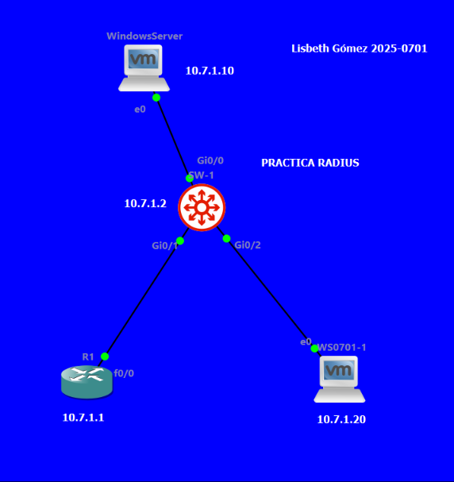](URL_DEL_VIDEO)

### ▶ [**Ver el video demostrativo**](URL_DEL_VIDEO)

</div>

**Qué se muestra en el video**

1. 🧭 La topología en GNS3 y el plan de direccionamiento.
2. 🏢 Active Directory: dominio `lab.local`, grupos `NIVEL-0 / 5 / 10` y usuarios.
3. 🛡️ NPS: clientes RADIUS (R1 y SW-1) y las tres políticas de red con el `Cisco-AV-Pair`.
4. 🔑 Inicio de sesión por consola con `user0`, `user5` y `user10` y los comandos que permite cada nivel.
5. 🔒 Acceso SSH con el usuario local y rechazo de usuarios de RADIUS por SSH.
6. 🧾 Logs: eventos 6272 / 6273 en el servidor, accounting de NPS y logs de login en los equipos.
7. 🛟 Respaldo: acceso con el usuario local cuando el servidor RADIUS no responde.

---

## 📑 Contenido

| | Sección |
|---|---|
| 🎯 | [Propósito del laboratorio](#-propósito-del-laboratorio) |
| ✅ | [Entregables y dónde encontrarlos](#-entregables-y-dónde-encontrarlos) |
| 🧭 | [Topología y direccionamiento](#-topología-y-direccionamiento) |
| 🔐 | [Cómo funciona AAA en este laboratorio](#-cómo-funciona-aaa-en-este-laboratorio) |
| 🧬 | [Niveles de privilegio 0 / 5 / 10](#-niveles-de-privilegio-0--5--10) |
| 🗂️ | [Estructura del repositorio](#️-estructura-del-repositorio) |
| 🛠️ | [Implementación por fases](#️-implementación-por-fases) |
| 🖼️ | [Evidencias destacadas](#️-evidencias-destacadas) |
| 🧪 | [Resultados de las pruebas](#-resultados-de-las-pruebas) |
| 📜 | [Scripts y running-configs](#-scripts-y-running-configs) |
| 👤 | [Autor](#-autor) |

---

## 🎯 Propósito del laboratorio

Demostrar cómo **centralizar el control de acceso administrativo** de la infraestructura de red. En lugar de crear usuarios en cada router o switch, los equipos Cisco le preguntan a un servidor **RADIUS (NPS)** que valida las credenciales contra **Active Directory** y devuelve el **nivel de privilegio** que le corresponde a cada usuario según su grupo.

**Objetivos**

- Configurar un router y un switch Cisco como **clientes RADIUS** con seguridad AAA en sus tres niveles: autenticación, autorización y *accounting*.
- Desplegar un servidor **Windows Server** con **Active Directory** (grupos de nivel 0, 5 y 10) y el servicio **NPS**.
- Limitar la autenticación y autorización por RADIUS a los puertos de **consola y auxiliar**, y dejar **SSH** con un **usuario local** de respaldo.
- Habilitar **logs** de autenticación, autorización y RADIUS en los equipos y en el servidor.
- Verificar el comportamiento con pruebas funcionales y dejar toda la evidencia documentada.

> Más detalle en [`docs/01-proposito-y-alcance.md`](docs/01-proposito-y-alcance.md).

---

## ✅ Entregables y dónde encontrarlos

| Requisito | Estado | Dónde |
|---|:---:|---|
| Video demostrativo al inicio del repositorio | ✅ | [Sección de video](#-video-demostrativo) |
| Documentación con imágenes | ✅ | [`docs/`](docs/) y [`docs/img/`](docs/img/) |
| Documentación con diagramas | ✅ | [`docs/02-arquitectura-y-diagramas.md`](docs/02-arquitectura-y-diagramas.md) |
| Propósito del laboratorio | ✅ | [Propósito](#-propósito-del-laboratorio) y [`docs/01`](docs/01-proposito-y-alcance.md) |
| Todos los scripts utilizados | ✅ | [`scripts/`](scripts/) |
| Running-configs | ✅ | [`running-configs/`](running-configs/) |

---

## 🧭 Topología y direccionamiento

<div align="center">
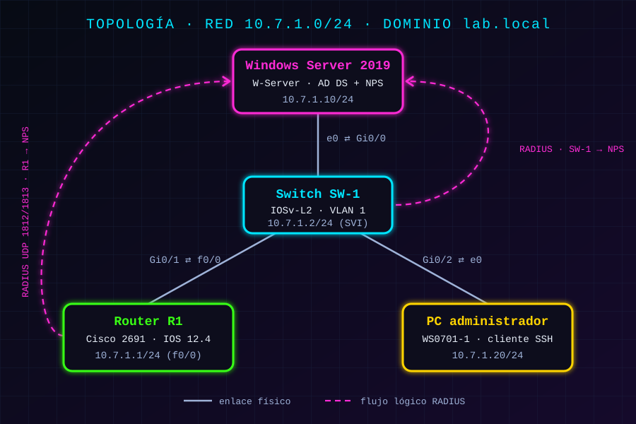
</div>

| Equipo | Rol | Interfaz | Dirección IP | Máscara |
|---|---|---|---|---|
| **W-Server** | Windows Server · AD DS + NPS | `e0` | `10.7.1.10` | `/24` |
| **SW-1** | Switch IOSv-L2 · cliente RADIUS | `Vlan1` (SVI) | `10.7.1.2` | `/24` |
| **R1** | Cisco 2691 · cliente RADIUS | `f0/0` | `10.7.1.1` | `/24` |
| **WS0701-1** | PC administradora (cliente SSH) | `e0` | `10.7.1.20` | `/24` |

**Conexiones:** `W-Server e0 ⇄ SW-1 Gi0/0` · `R1 f0/0 ⇄ SW-1 Gi0/1` · `WS0701-1 e0 ⇄ SW-1 Gi0/2`

---

## 🔐 Cómo funciona AAA en este laboratorio

<div align="center">
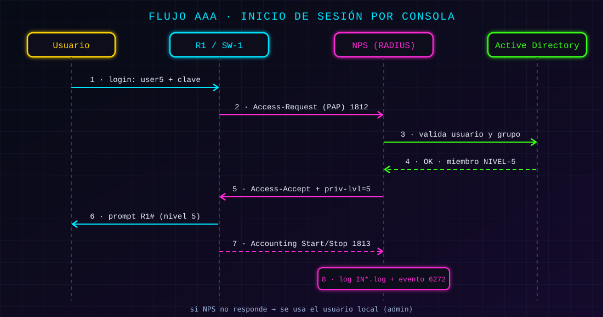
</div>

| Componente | Función |
|---|---|
| **Authentication** | El equipo envía usuario y clave a NPS, que valida contra Active Directory (PAP) |
| **Authorization** | NPS responde con `Cisco-AV-Pair = shell:priv-lvl=N` según el grupo del usuario |
| **Accounting** | R1 y SW-1 envían inicio y fin de sesión a NPS (UDP 1813); NPS lo guarda en `IN*.log` |
| **Respaldo** | Si el servidor no responde, la consola acepta al usuario local `admin` (nivel 15) |
| **SSH** | Líneas `vty` con usuario local (`admin`) y SSH versión 2 |

---

## 🧬 Niveles de privilegio 0 / 5 / 10

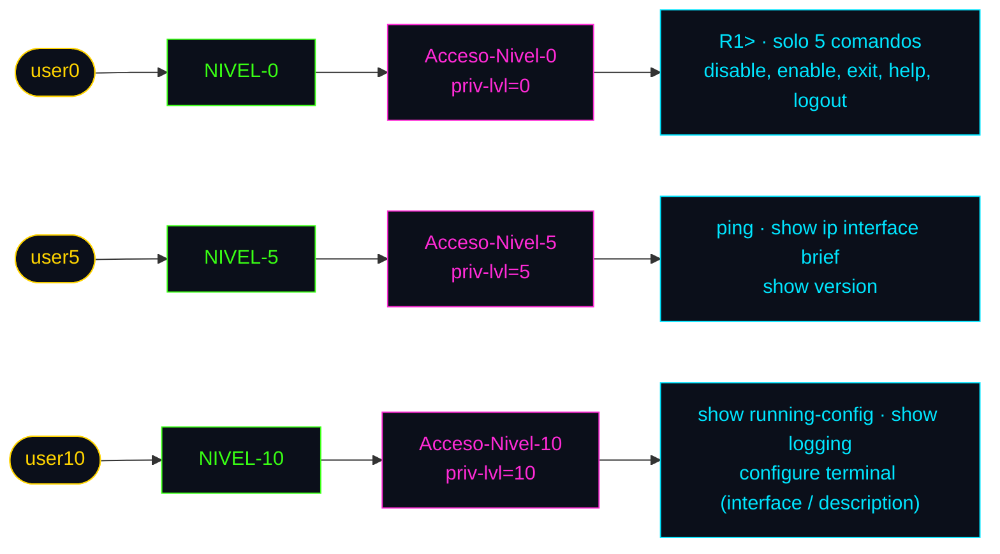

---

## 🗂️ Estructura del repositorio

```text
AAA-RADIUS-NPS-GNS3/
├── README.md                      ← estás aquí
├── assets/
│   └── banner.svg
├── docs/
│   ├── 01-proposito-y-alcance.md
│   ├── 02-arquitectura-y-diagramas.md
│   ├── 03-windows-server-ad-nps.md
│   ├── 04-router-r1.md
│   ├── 05-switch-sw1.md
│   ├── 06-pruebas-y-evidencias.md
│   ├── 07-notas-tecnicas.md
│   ├── diagramas/                 ← diagramas SVG
│   └── img/                       ← capturas de pantalla
├── scripts/
│   ├── windows/                   ← PowerShell del Windows Server
│   └── cisco/                     ← comandos aplicados en R1 y SW-1
├── running-configs/
│   ├── R1-running-config.txt
│   └── SW-1-running-config.txt
└── topologia/                     ← proyecto de GNS3
```

---

## 🛠️ Implementación por fases

| Fase | Qué se hace | Documento | Scripts |
|:---:|---|---|---|
| **1** | Red, nombre del servidor, Active Directory, OU, grupos y usuarios | [`docs/03`](docs/03-windows-server-ad-nps.md) | [`scripts/windows/`](scripts/windows/) |
| **2** | NPS: clientes RADIUS, políticas de red con `Cisco-AV-Pair`, auditoría y accounting | [`docs/03`](docs/03-windows-server-ad-nps.md) | [`04-nps.ps1`](scripts/windows/04-nps.ps1) |
| **3** | Router R1: usuario local, SSH, RADIUS, listas AAA, privilegios, logs y líneas | [`docs/04`](docs/04-router-r1.md) | [`R1-comandos.txt`](scripts/cisco/R1-comandos.txt) |
| **4** | Switch SW-1: misma configuración con la sintaxis de IOSv | [`docs/05`](docs/05-switch-sw1.md) | [`SW-1-comandos.txt`](scripts/cisco/SW-1-comandos.txt) |
| **5** | Pruebas, logs y evidencias | [`docs/06`](docs/06-pruebas-y-evidencias.md) | [`05-verificacion.ps1`](scripts/windows/05-verificacion.ps1) |

---

## 🖼️ Evidencias destacadas

<table>
  <tr>
    <td align="center">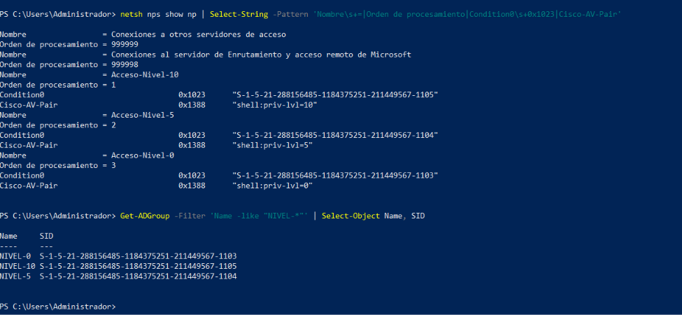<br/><sub><b>Políticas NPS</b> · grupo, orden y Cisco-AV-Pair</sub></td>
    <td align="center">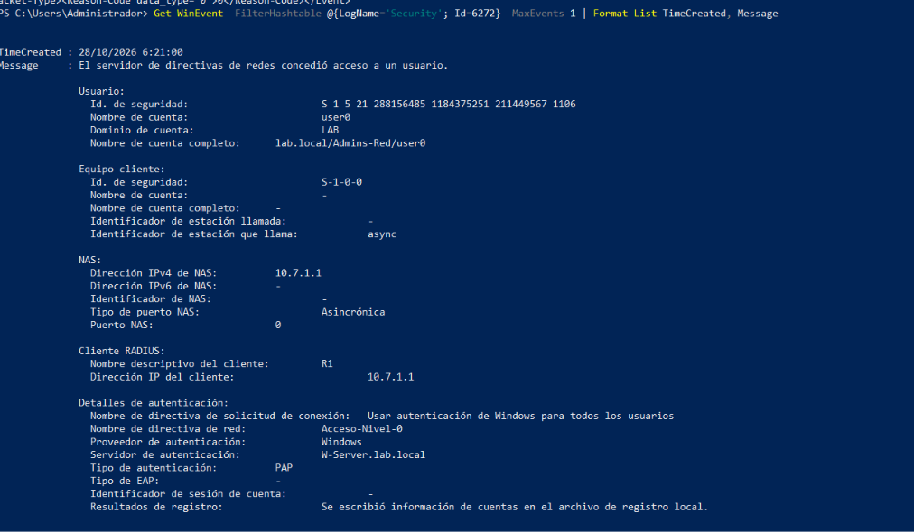<br/><sub><b>Evento 6272</b> · acceso concedido por NPS</sub></td>
    <td align="center">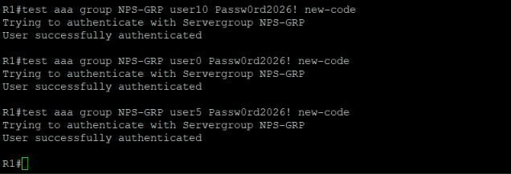<br/><sub><b>test aaa</b> · R1 autentica contra NPS</sub></td>
  </tr>
  <tr>
    <td align="center">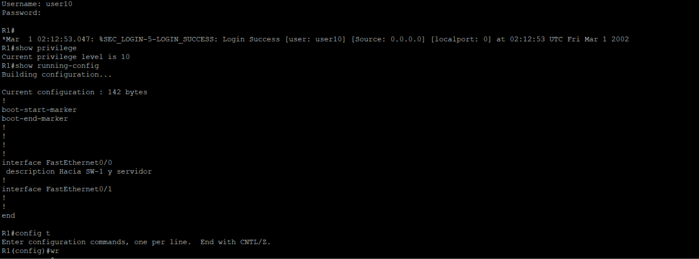<br/><sub><b>user10</b> · nivel 10 en consola</sub></td>
    <td align="center">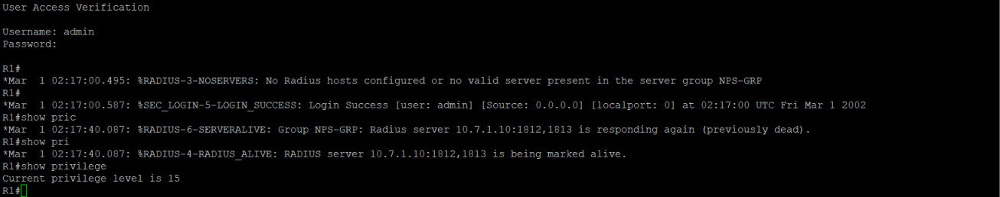<br/><sub><b>Respaldo</b> · acceso local sin servidor</sub></td>
    <td align="center">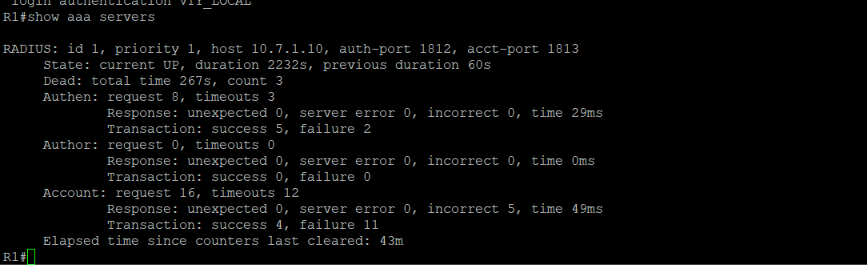<br/><sub><b>show aaa servers</b> · estado y contadores</sub></td>
  </tr>
</table>

---

## 🧪 Resultados de las pruebas

| # | Prueba | Resultado |
|:---:|---|:---:|
| 1 | Conectividad entre servidor, R1, SW-1 y la PC | ✅ |
| 2 | `test aaa` de `user0`, `user5` y `user10` en R1 y SW-1 | ✅ |
| 3 | Consola con `user0` → nivel 0 (5 comandos) | ✅ |
| 4 | Consola con `user5` → nivel 5 (`show ip interface brief`, sin `show running-config`) | ✅ |
| 5 | Consola con `user10` → nivel 10 (`show running-config` y `configure terminal`) | ✅ |
| 6 | SSH con el usuario local `admin` → nivel 15 | ✅ |
| 7 | SSH con `user5` (usuario de RADIUS) → rechazado | ✅ |
| 8 | Clave incorrecta → `User rejected` y evento 6273 | ✅ |
| 9 | Servidor apagado → acceso por consola con `admin` | ✅ |
| 10 | Logs: eventos 6272 / 6273, accounting de NPS y logs de login | ✅ |

> Detalle y capturas de cada prueba en [`docs/06-pruebas-y-evidencias.md`](docs/06-pruebas-y-evidencias.md).

---

## 📜 Scripts y running-configs

| Archivo | Contenido |
|---|---|
| [`scripts/windows/01-red-y-nombre.ps1`](scripts/windows/01-red-y-nombre.ps1) | IP estática, regla de ping y nombre del servidor |
| [`scripts/windows/02-active-directory.ps1`](scripts/windows/02-active-directory.ps1) | Instalación de AD DS y creación del bosque `lab.local` |
| [`scripts/windows/03-ou-grupos-usuarios.ps1`](scripts/windows/03-ou-grupos-usuarios.ps1) | OU, grupos `NIVEL-0/5/10` y usuarios |
| [`scripts/windows/04-nps.ps1`](scripts/windows/04-nps.ps1) | Instalación de NPS, clientes RADIUS, firewall y auditoría |
| [`scripts/windows/05-verificacion.ps1`](scripts/windows/05-verificacion.ps1) | Comandos de verificación y logs |
| [`scripts/cisco/R1-comandos.txt`](scripts/cisco/R1-comandos.txt) | Comandos aplicados en el router |
| [`scripts/cisco/SW-1-comandos.txt`](scripts/cisco/SW-1-comandos.txt) | Comandos aplicados en el switch |
| [`running-configs/R1-running-config.txt`](running-configs/R1-running-config.txt) | `running-config` de R1 |
| [`running-configs/SW-1-running-config.txt`](running-configs/SW-1-running-config.txt) | `running-config` de SW-1 |

> ⚠️ Las credenciales que aparecen en este repositorio son **solo de laboratorio**.

---

## 👤 Autor

<div align="center">

**Lisbeth Gómez** · Matrícula **2025-0701**

Laboratorio de seguridad en redes · AAA con RADIUS y NPS

<sub>Hecho con 💜 y mucha consola.</sub>

</div>
