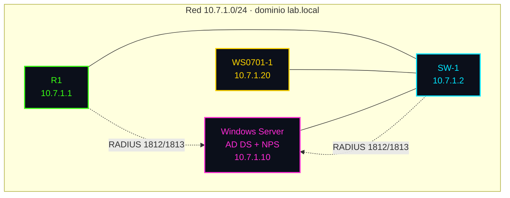
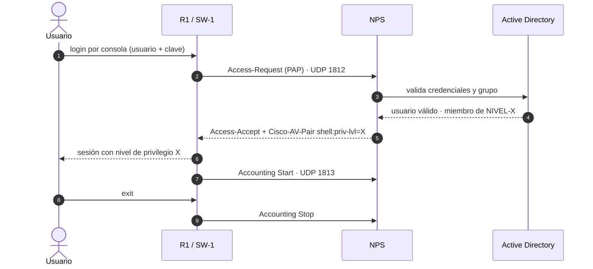
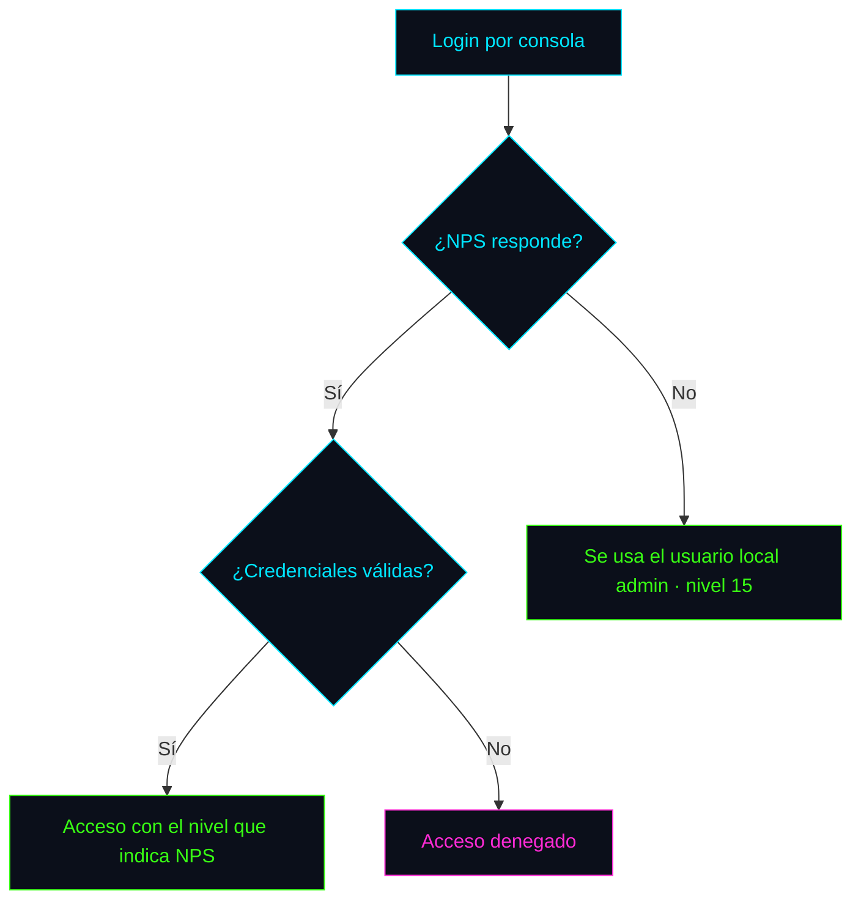
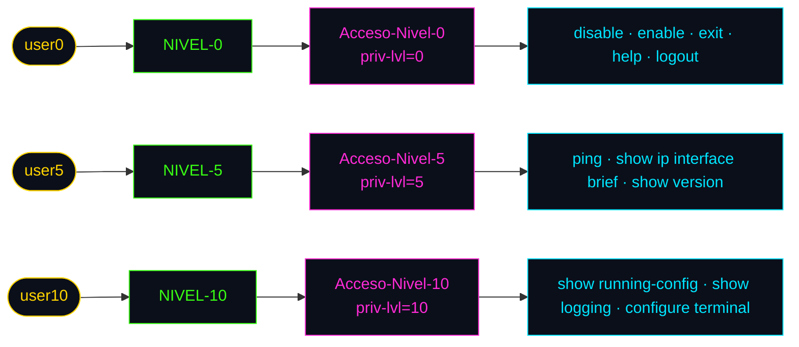

# 🧭 02 · Arquitectura y diagramas

[⬅ Anterior](01-proposito-y-alcance.md) · [Volver al README](../README.md) · [Siguiente ➡](03-windows-server-ad-nps.md)

## 1. Topología

Topología tal como se ve en GNS3:

### Diagrama lógico

## 2. Plan de direccionamiento

| Equipo | Interfaz | IP | Máscara | Gateway |
|---|---|---|---|---|
| W-Server | `e0` | 10.7.1.10 | 255.255.255.0 | 10.7.1.1 |
| SW-1 | `Vlan1` | 10.7.1.2 | 255.255.255.0 | 10.7.1.1 |
| R1 | `f0/0` | 10.7.1.1 | 255.255.255.0 | n/a |
| WS0701-1 | `e0` | 10.7.1.20 | 255.255.255.0 | 10.7.1.1 |

## 3. Flujo de una autenticación

## 4. ¿Qué pasa si el servidor no responde?

## 5. Niveles de privilegio

| Usuario | Grupo de AD | Política de NPS | Orden | Cisco-AV-Pair |
|---|---|---|:---:|---|
| `user10` | `NIVEL-10` | `Acceso-Nivel-10` | 1 | `shell:priv-lvl=10` |
| `user5` | `NIVEL-5` | `Acceso-Nivel-5` | 2 | `shell:priv-lvl=5` |
| `user0` | `NIVEL-0` | `Acceso-Nivel-0` | 3 | `shell:priv-lvl=0` |

## 6. Decisiones de diseño

| Decisión | Motivo |
|---|---|
| RADIUS solo en `con 0` y `aux 0` | Cumple el requisito de limitar autenticación y autorización a esos puertos |
| Líneas `vty` con usuario local | SSH siempre disponible, aunque el servidor falle |
| Listas con nombre (`CON_AUX_AUTH`, `VTY_LOCAL`) | Permiten aplicar cada método solo donde corresponde |
| Respaldo local (`group NPS-GRP local`) | Acceso de emergencia si NPS no responde |
| Autenticación PAP en NPS | Es el método que usa IOS para el login de administración |
| Políticas ordenadas de mayor a menor nivel | Si un usuario está en varios grupos, recibe el nivel más alto |
