# 🟢 04 · Router R1

[⬅ Anterior](03-windows-server-ad-nps.md) · [Volver al README](../README.md) · [Siguiente ➡](05-switch-sw1.md)

> Comandos completos en [`scripts/cisco/R1-comandos.txt`](../scripts/cisco/R1-comandos.txt) · Configuración final en [`running-configs/R1-running-config.txt`](../running-configs/R1-running-config.txt)

**Equipo:** Cisco 2691 · IOS 12.4(25d) · `FastEthernet0/0` = `10.7.1.1/24`

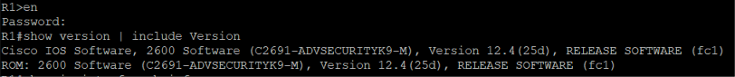

---

## 4.1 Base, IP y usuario local

```text
configure terminal
hostname R1
no ip domain-lookup
ip domain-name lab.local
service timestamps log datetime msec
service timestamps debug datetime msec
service password-encryption
banner motd # Acceso autorizado solamente #

interface FastEthernet0/0
 description Hacia SW-1 y servidor
 ip address 10.7.1.1 255.255.255.0
 no shutdown
exit

username admin privilege 15 secret Cisco2026!
enable secret Enable2026!
end
```

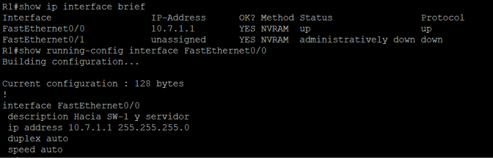

Conectividad con el switch, el servidor y la PC:

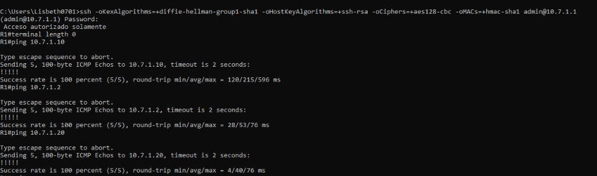

Usuario local y `enable secret` (almacenados como hash):

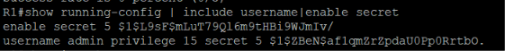

---

## 4.2 SSH

```text
crypto key generate rsa          ! tamaño del módulo: 1024
ip ssh version 2
ip ssh time-out 60
ip ssh authentication-retries 3
```

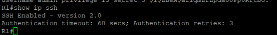

---

## 4.3 RADIUS (cliente de NPS)

```text
aaa new-model

radius-server host 10.7.1.10 auth-port 1812 acct-port 1813 key Radius2026!
radius-server timeout 3
radius-server retransmit 1
aaa group server radius NPS-GRP
 server 10.7.1.10 auth-port 1812 acct-port 1813
exit
ip radius source-interface FastEthernet0/0
radius-server dead-criteria time 5 tries 3
radius-server deadtime 1
end
```

> `ip radius source-interface` hace que las solicitudes salgan con la IP `10.7.1.1`, que es la registrada como cliente RADIUS en NPS.

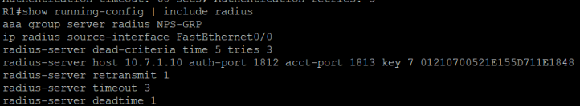

Pruebas contra el servidor:

```text
test aaa group NPS-GRP user10 Passw0rd2026! new-code
test aaa group NPS-GRP user5  Passw0rd2026! new-code
test aaa group NPS-GRP user0  Passw0rd2026! new-code
```


Con una clave incorrecta el servidor rechaza la autenticación:

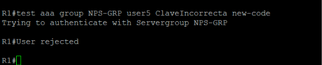

---

## 4.4 Listas AAA

```text
aaa authentication login CON_AUX_AUTH group NPS-GRP local
aaa authorization console
aaa authorization exec CON_AUX_AUTHZ group NPS-GRP local
aaa accounting exec CON_AUX_ACCT start-stop group NPS-GRP

aaa authentication login VTY_LOCAL local
aaa authorization exec VTY_LOCAL local
aaa authentication enable default enable
aaa accounting system default start-stop group NPS-GRP
```

| Lista | Dónde se aplica | Método |
|---|---|---|
| `CON_AUX_AUTH` / `CON_AUX_AUTHZ` / `CON_AUX_ACCT` | Consola y auxiliar | RADIUS, con el usuario local como respaldo |
| `VTY_LOCAL` | SSH (`vty`) | Usuario local |

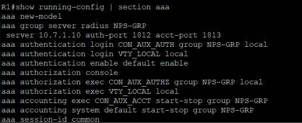

---

## 4.5 Niveles de privilegio

```text
privilege exec level 10 show running-config
privilege exec level 10 show logging
privilege exec level 10 configure terminal
privilege configure level 10 interface
privilege interface level 10 description

privilege exec level 5 ping
privilege exec level 5 show ip interface brief
privilege exec level 5 show version
privilege exec level 5 show
```

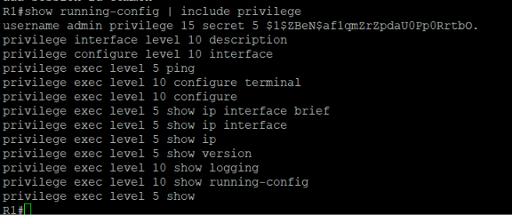

---

## 4.6 Logs

```text
logging buffered 16384 informational
login block-for 30 attempts 3 within 60
login on-success log
login on-failure log
archive
 log config
  logging enable
exit
```

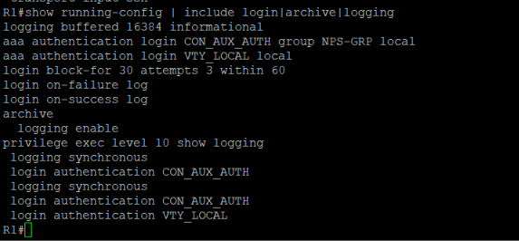

---

## 4.7 Líneas de consola, auxiliar y vty

```text
line con 0
 login authentication CON_AUX_AUTH
 authorization exec CON_AUX_AUTHZ
 accounting exec CON_AUX_ACCT
 no privilege level
 exec-timeout 5 0
 logging synchronous
exit
line aux 0
 login authentication CON_AUX_AUTH
 authorization exec CON_AUX_AUTHZ
 accounting exec CON_AUX_ACCT
 no privilege level
 exec-timeout 5 0
 logging synchronous
exit
line vty 0 4
 login authentication VTY_LOCAL
 authorization exec VTY_LOCAL
 transport input ssh
 exec-timeout 5 0
exit
end
write memory
```

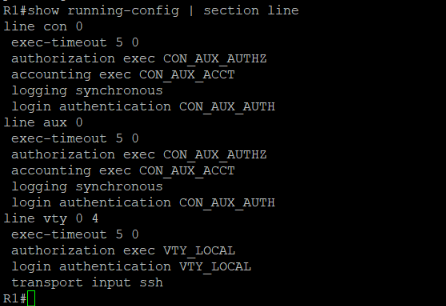

---

## 4.8 Estado del servidor RADIUS y configuración guardada

```text
show aaa servers
```

El servidor `10.7.1.10` aparece en estado `UP`, con los contadores de autenticación y de accounting:


La configuración se guarda y queda en la startup-config:

```text
write memory
show startup-config | include aaa new-model
```

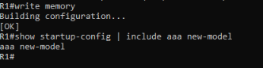
