# 🔷 05 · Switch SW-1

[⬅ Anterior](04-router-r1.md) · [Volver al README](../README.md) · [Siguiente ➡](06-pruebas-y-evidencias.md)

> Comandos completos en [`scripts/cisco/SW-1-comandos.txt`](../scripts/cisco/SW-1-comandos.txt) · Configuración final en [`running-configs/SW-1-running-config.txt`](../running-configs/SW-1-running-config.txt)

**Equipo:** Cisco IOSv-L2 · `Vlan1` = `10.7.1.2/24`

La configuración AAA es la misma que la del router; cambian la interfaz de administración y la sintaxis de RADIUS, que en IOSv usa `radius server`.

---

## 5.1 Base, VLAN 1 y usuario local

```text
configure terminal
hostname SW-1
no ip domain-lookup
ip domain-name lab.local
service timestamps log datetime msec
service timestamps debug datetime msec
service password-encryption
banner motd # Acceso autorizado solamente #

interface vlan 1
 description Administracion
 ip address 10.7.1.2 255.255.255.0
 no shutdown
exit
ip default-gateway 10.7.1.1

username admin privilege 15 secret Cisco2026!
enable secret Enable2026!
end
```

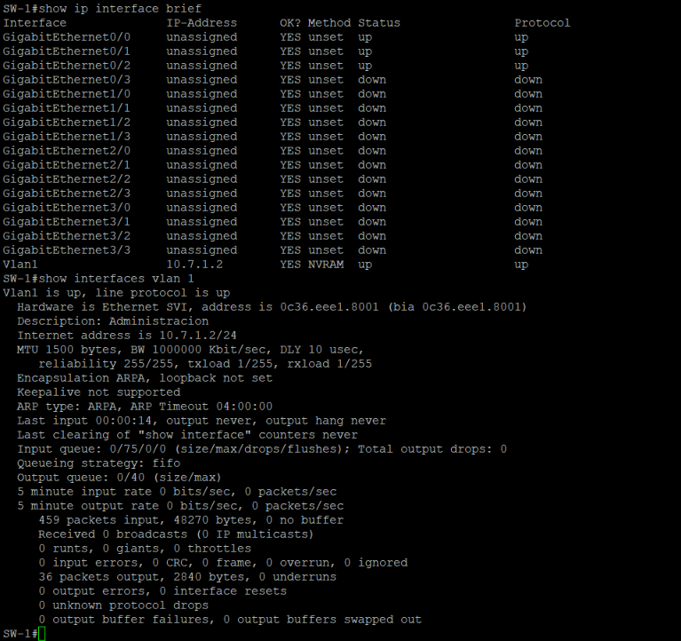

Todos los puertos están en la VLAN 1 y el switch ve a R1 por CDP:

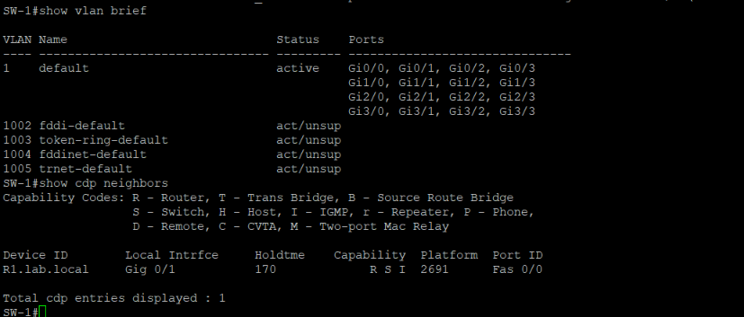

Conectividad con el router, el servidor y la PC:

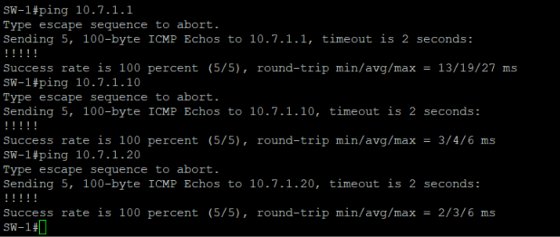

Usuario local y `enable secret`:

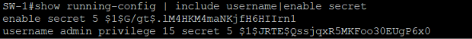

---

## 5.2 SSH

```text
crypto key generate rsa modulus 2048
ip ssh version 2
ip ssh time-out 60
ip ssh authentication-retries 3
```

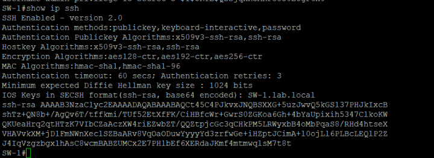

---

## 5.3 RADIUS y listas AAA

```text
aaa new-model

radius server NPS-SRV
 address ipv4 10.7.1.10 auth-port 1812 acct-port 1813
 key Radius2026!
 timeout 3
 retransmit 1
exit
aaa group server radius NPS-GRP
 server name NPS-SRV
exit
ip radius source-interface Vlan1
radius-server dead-criteria time 5 tries 3
radius-server deadtime 1

aaa authentication login CON_AUX_AUTH group NPS-GRP local
aaa authorization console
aaa authorization exec CON_AUX_AUTHZ group NPS-GRP local
aaa accounting exec CON_AUX_ACCT start-stop group NPS-GRP

aaa authentication login VTY_LOCAL local
aaa authorization exec VTY_LOCAL local
aaa authentication enable default enable
aaa accounting system default start-stop group NPS-GRP
end
```

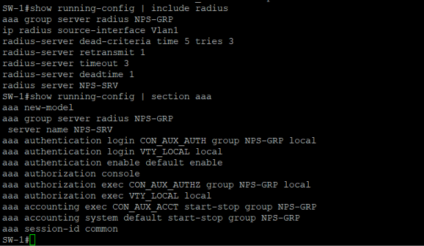

Prueba contra NPS. En IOSv, `test aaa` también muestra el atributo `priv-lvl` que devuelve el servidor:

```text
test aaa group NPS-GRP user10 Passw0rd2026! new-code
test aaa group NPS-GRP user5  Passw0rd2026! new-code
test aaa group NPS-GRP user0  Passw0rd2026! new-code
```

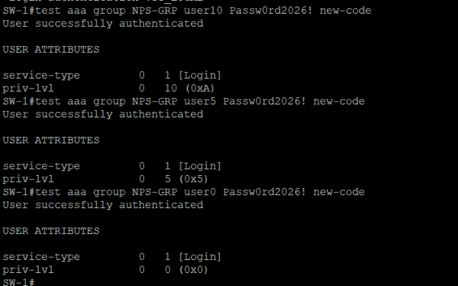

---

## 5.4 Niveles de privilegio y líneas

```text
privilege exec level 10 show running-config
privilege exec level 10 show logging
privilege exec level 10 configure terminal
privilege configure level 10 interface
privilege interface level 10 description

privilege exec level 5 ping
privilege exec level 5 show ip interface brief
privilege exec level 5 show version
privilege exec level 5 show

line con 0
 login authentication CON_AUX_AUTH
 authorization exec CON_AUX_AUTHZ
 accounting exec CON_AUX_ACCT
 no privilege level
 exec-timeout 5 0
 logging synchronous
exit
line aux 0
 login authentication CON_AUX_AUTH
 authorization exec CON_AUX_AUTHZ
 accounting exec CON_AUX_ACCT
 exec-timeout 5 0
exit
line vty 0 4
 login authentication VTY_LOCAL
 authorization exec VTY_LOCAL
 transport input ssh
 exec-timeout 5 0
exit
line vty 5 15
 login authentication VTY_LOCAL
 authorization exec VTY_LOCAL
 transport input ssh
 exec-timeout 5 0
exit
end
```

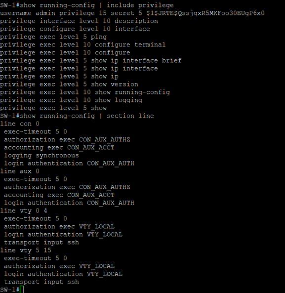

---

## 5.5 Logs

```text
logging buffered 16384 informational
login block-for 30 attempts 3 within 60
login on-success log
login on-failure log
archive
 log config
  logging enable
exit
```

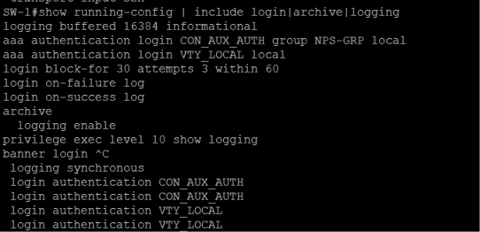

---

## 5.6 Estado del servidor RADIUS y configuración guardada

```text
show aaa servers
write memory
show startup-config | include aaa new-model
```

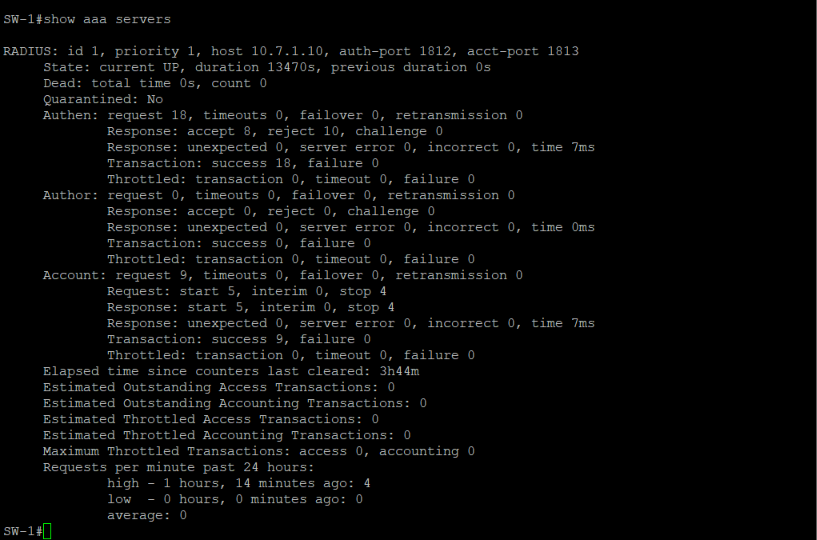

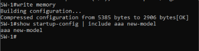
