# 🧪 06 · Pruebas y evidencias

[⬅ Anterior](05-switch-sw1.md) · [Volver al README](../README.md) · [Siguiente ➡](07-notas-tecnicas.md)

## Resumen de pruebas

| # | Prueba | Resultado esperado | Resultado | Evidencia |
|:---:|---|---|:---:|---|
| 1 | Conectividad de la PC con R1, SW-1 y el servidor | Respuesta de los tres | ✅ | [6.1](#61-conectividad) |
| 2 | `test aaa` con los tres usuarios | `User successfully authenticated` | ✅ | [6.2](#62-autenticación-contra-nps) |
| 3 | Consola con `user0` | Nivel 0 · solo 5 comandos | ✅ | [6.3](#63-niveles-de-privilegio-por-consola) |
| 4 | Consola con `user5` | Nivel 5 · sin `show running-config` | ✅ | [6.3](#63-niveles-de-privilegio-por-consola) |
| 5 | Consola con `user10` | Nivel 10 · `show running-config` y `configure terminal` | ✅ | [6.3](#63-niveles-de-privilegio-por-consola) |
| 6 | SSH con el usuario local `admin` | Acceso con nivel 15 | ✅ | [6.4](#64-ssh) |
| 7 | SSH con `user5` (usuario de RADIUS) | Acceso rechazado | ✅ | [6.4](#64-ssh) |
| 8 | Clave incorrecta | `User rejected` y evento 6273 | ✅ | [6.5](#65-logs-y-eventos) |
| 9 | Servidor RADIUS apagado | Acceso por consola con el usuario local | ✅ | [6.6](#66-respaldo-con-el-usuario-local) |
| 10 | Logs de login, eventos de NPS y accounting | Registros de éxitos y fallos | ✅ | [6.5](#65-logs-y-eventos) |

---

## 6.1 Conectividad

Desde la PC administradora (`WS0701-1`):

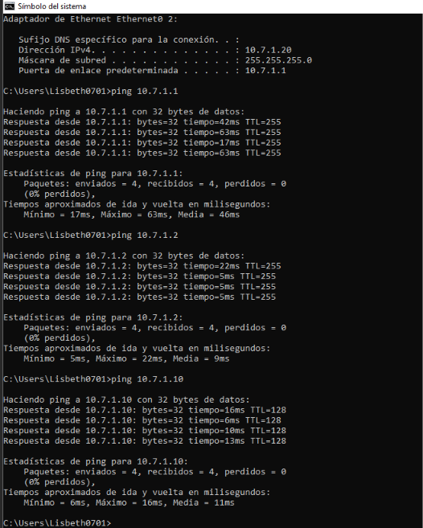

---

## 6.2 Autenticación contra NPS

Los tres usuarios se autentican correctamente en el router y en el switch.

| R1 | SW-1 |
|---|---|
|  |  |

Estado del servidor RADIUS visto desde cada equipo:

| R1 | SW-1 |
|---|---|
|  |  |

---

## 6.3 Niveles de privilegio por consola

### Nivel 0 · `user0`

El prompt es `>` y solo hay cinco comandos disponibles.

| R1 | SW-1 |
|---|---|
| 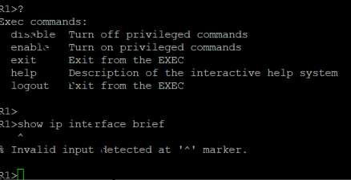 | 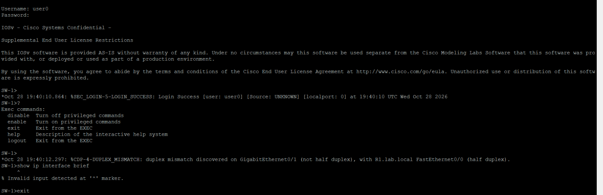 |

### Nivel 5 · `user5`

`show privilege` indica nivel 5, `show ip interface brief` funciona y `show running-config` es rechazado.

| R1 | SW-1 |
|---|---|
| 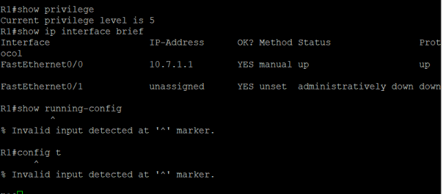 | 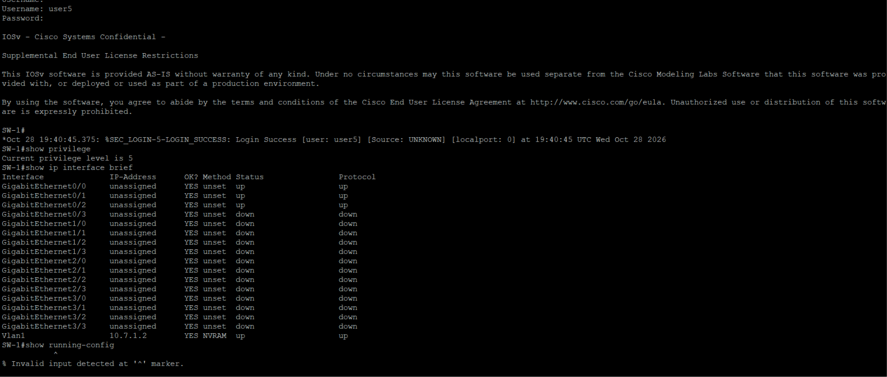 |

### Nivel 10 · `user10`

`show privilege` indica nivel 10, y puede usar `show running-config` y `configure terminal`. Con este nivel, `show running-config` muestra solo las secciones que el nivel puede ver.

| R1 | SW-1 |
|---|---|
|  | 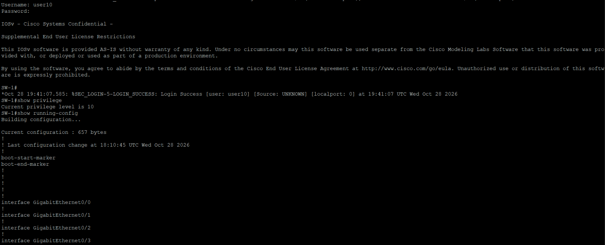 |
| | 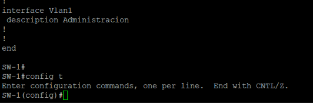 |

---

## 6.4 SSH

### Usuario local `admin` → aceptado (nivel 15)

| R1 | SW-1 |
|---|---|
| 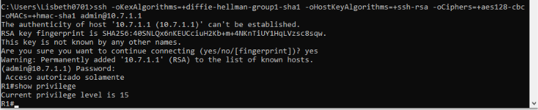 | 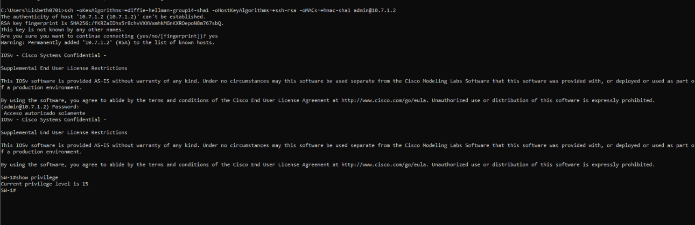 |

### Usuario de RADIUS `user5` → rechazado

Las líneas `vty` usan solo el usuario local, así que una cuenta de Active Directory no entra por SSH:

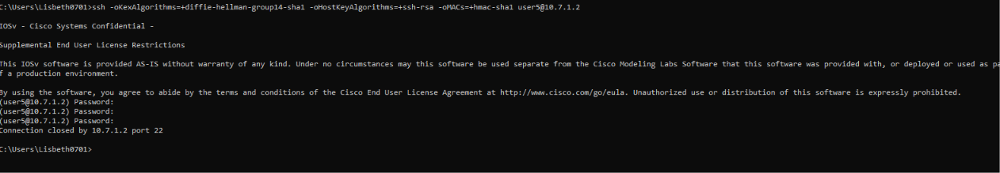

---

## 6.5 Logs y eventos

### En el switch

`show logging | include LOGIN` y `show login failures` registran los accesos correctos, los fallidos y el modo silencioso (`login block-for`):

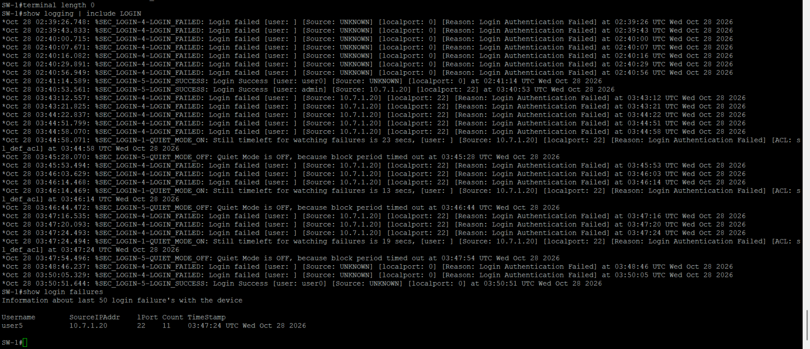

### En el servidor (Visor de eventos)

Eventos **6272** (acceso concedido) y **6273** (acceso denegado) filtrados en el registro de Seguridad:

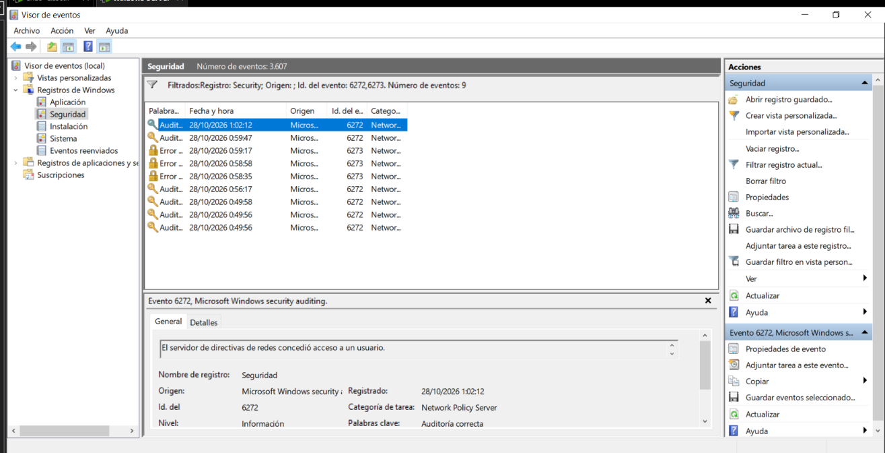

```powershell
Get-WinEvent -FilterHashtable @{LogName='Security'; Id=6272} -MaxEvents 1 | Format-List TimeCreated, Message
Get-WinEvent -FilterHashtable @{LogName='Security'; Id=6273} -MaxEvents 1 | Format-List TimeCreated, Message
```

| Evento 6272 · acceso concedido | Evento 6273 · acceso denegado |
|---|---|
|  | 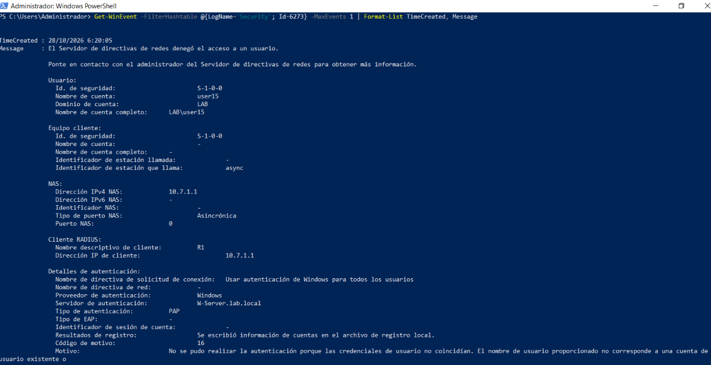 |

El evento 6272 muestra el usuario, el cliente RADIUS (`R1`, `10.7.1.1`) y la política aplicada (`Acceso-Nivel-0`). El 6273 corresponde a un usuario inexistente en AD (código de motivo 16).

### Accounting de NPS


---

## 6.6 Respaldo con el usuario local

Con el servidor apagado, el router informa que no hay servidores RADIUS disponibles y la consola acepta al usuario local `admin` con nivel 15. Cuando el servidor vuelve, el router lo marca otra vez como activo.


